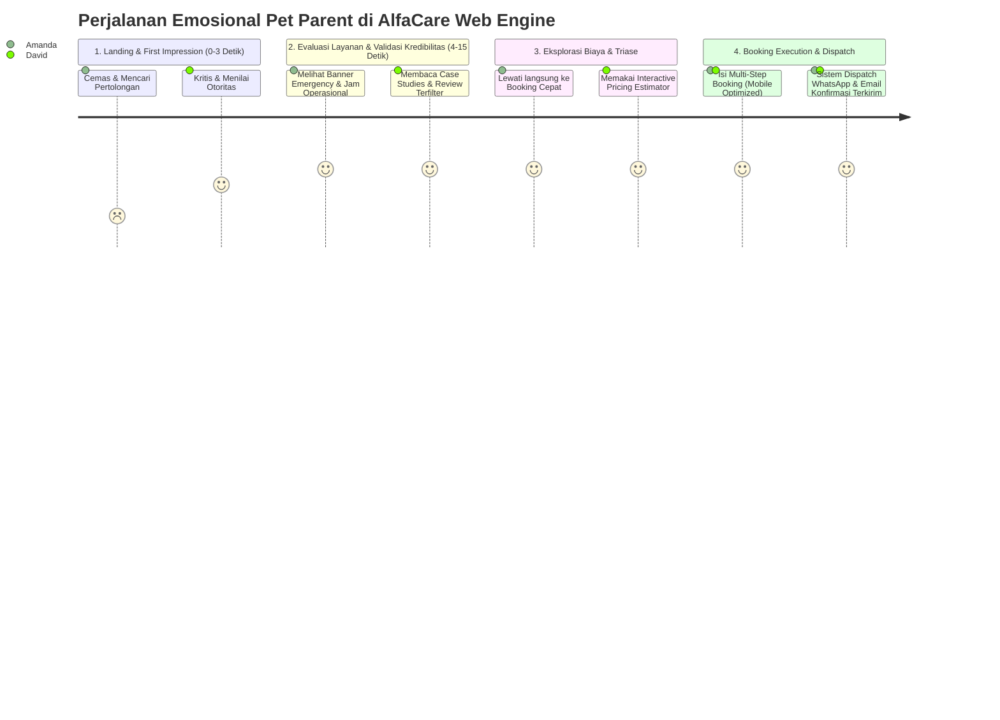

# PRODUCT REQUIREMENTS DOCUMENT (PRD)
## AlfaCare Animal Clinic — High-Performance Lead Capture & Local Service Platform

---

### METADATA DOKUMEN
- **Nama Produk:** Platform Web Resmi & Lead Generation Engine AlfaCare Animal Clinic
- **Entitas Bisnis:** AlfaCare Animal Clinic
- **Lokasi Layanan:** DKI Jakarta, Indonesia (Layanan Klinis, Rawat Inap, Bedah, dan Layanan Darurat)
- **Versi Dokumen:** 1.0.0
- **Status:** Final / Ready for Architecture & Sprint Planning
- **Disusun Oleh:** Senior Technical Product Manager & Lead Full-Stack Architect
- **Klasifikasi:** Dokumen Spesifikasi Produk & Arsitektur Teknis

---

## 1. EXECUTIVE SUMMARY & BUSINESS OBJECTIVES

### 1.1 Visi Produk
Platform web AlfaCare Animal Clinic bukan sekadar brosur digital statis, melainkan **High-Performance Lead Capture Engine** dan pusat interaksi digital yang dirancang untuk mengonversi pemilik hewan (*pet parents*) di area Jakarta menjadi klien aktif klinik. Platform ini mengintegrasikan kemudahan navigasi medis darurat, transparansi estimasi biaya, alur booking interaktif multitahap, dan notifikasi instan berbasis WhatsApp dan Email.

### 1.2 Proposisi Nilai (Value Proposition)
1. **Kecepatan & Responsivitas Medis Darurat:** Pemilik hewan dalam kondisi gawat darurat dapat mengakses triase cepat dan kontak darurat dalam hitungan detik (di bawah 2 klik).
2. **Transparansi Tanpa Friksi:** Menghilangkan ketakutan terbesar pemilik hewan (*pricing anxiety*) melalui kalkulator estimasi biaya interaktif sebelum reservasi.
3. **Kredibilitas Medis Lokal Tinggi:** Menampilkan rekam jejak medis nyata melalui studi kasus pemulihan terfilter (*verified case studies*) dan ulasan terverifikasi.
4. **Dukungan Bilingual Penuh (ID/EN):** Melayani segmen pemilik hewan lokal maupun komunitas ekspatriat/internasional di Jakarta secara seamless.

### 1.3 Key Performance Indicators (KPI) & Metrik Keberhasilan Bisnis

| Metrik Kunci | Baseline Industri (Veterinary) | Target AlfaCare Platform | Pengukuran |
| :--- | :--- | :--- | :--- |
| **Overall Conversion Rate (CR)** | 2.5% – 3.8% | **≥ 8.5%** | Total Leads (Booking + WhatsApp Dispatch) / Total Unique Visitors |
| **Mobile Form Completion Rate** | 35% – 45% | **≥ 70%** | Pengguna yang memulai Step 1 Booking hingga selesai Submit Step 4 |
| **Emergency CTA Click-Through** | 4.0% | **≥ 12.0%** | Klik pada Floating Hotline / Emergency Button pada sesi mobile |
| **Average Page Load Time (LCP)** | 3.5 detik | **≤ 1.2 detik** | Core Web Vitals (Google PageSpeed Mobile ≥ 90) |
| **Local Lead-to-Visit Ratio** | 40% | **≥ 68%** | Pasien yang benar-benar datang ke klinik fisik setelah dispatch WhatsApp |
| **Estimator-to-Booking Flow** | N/A | **≥ 35%** | Pengguna kalkulator biaya yang melanjutkan klik *"Kunci Estimasi & Booking"* |

---

## 2. USER PERSONAS & EMOTIONAL JOURNEY MAPPING

### 2.1 Persona Analisis

#### Persona A: "The Anxious Urgent Parent" (Kondisi Kritis / Darurat)
- **Demografi:** Amanda (29 tahun), Karyawan Swasta di Jakarta Selatan, memelihara kucing Persia berusia 2 tahun.
- **Skenario:** Kucingnya tiba-tiba lemas, muntah berulang kali pada jam 21:00 WIB, dan menunjukkan tanda dehidrasi akut.
- **Kondisi Emosional:** Panik tinggi, ketakutan kehilangan peliharaan, kognitif menurun (*cognitive overload*), tidak sabar membaca paragraf panjang.
- **Kebutuhan Utama:** Tombol darurat instan, konfirmasi apakah klinik buka/ada dokter jaga, rute Google Maps instan, nomor darurat WhatsApp 1-tap.
- **Pain Points:** Website lambat loading, form booking yang meminta terlalu banyak input teks, tidak ada nomor kontak darurat yang jelas.

#### Persona B: "The Meticulous Preventive Parent" (Perawatan Rutin & Terencana)
- **Demografi:** David (38 tahun), Ekspatriat / Tech Lead di Jakarta Pusat, memelihara Golden Retriever berusia 4 tahun.
- **Skenario:** Memerlukan vaksin tahunan lengkap, pemeriksaan gigi (*dental scaling*), dan grooming medis anti-kutu.
- **Kondisi Emosional:** Rasional, teliti, peduli standar sterilisasi dan kompetensi dokter hewan (*veterinarian credentials*), membandingkan harga.
- **Kebutuhan Utama:** Bahasa Inggris yang natural, transparansi rincian harga, portofolio fasilitas steril, testimoni kasus serupa, jadwal booking terstruktur.
- **Pain Points:** Harga yang disembunyikan ("DM kami untuk harga"), testimoni palsu tanpa rincian medis, form booking tanpa kepastian slot waktu.

### 2.2 Emotional Journey Map & Conversion Triggers



---

## 3. INFORMATION ARCHITECTURE & SITEMAP

### 3.1 Peta Situs (Sitemap Structure)
```
/ (Root Homepage - Primary Landing Page)
├── Hero Section (Value Prop, Trust Badges, Quick CTA, Dual Language Switcher)
├── Emergency Triage Bar (24/7 Support status, Hotline, One-Tap WhatsApp)
├── Core Services Grid (Konsultasi, Bedah/Steril, Dental, Vaksin, Rawat Inap)
├── Interactive Pricing Estimator (Kalkulator Biaya Terbuka)
├── Multi-Step Booking Funnel (Direct Anchor / Interactive Widget)
├── Verified Case Studies & Recovery Showcase (Filterable + Detail Modals)
├── Veterinarian Team & Hospital Facilities (Akreditasi & Sertifikasi)
├── Local Clinic Info (Peta Interaktif, Jam Buka, Parkir, Pet-Friendly Rules)
└── Footer (SEO Local Links, Kontak Darurat, Legal, Hak Cipta)

/en/ (Struktur Bahasa Inggris Simetris Penuh)
```

### 3.2 Wireframe Hierarchy & Visual Layout Flow
1. **Header Sticky:** Logo AlfaCare + Indikator Status ("Dokter Jaga Standby") + Navigasi Ringkas + Language Toggle (ID/EN) + Tombol Merah `Hotline Darurat`.
2. **Hero Section:**
   - H1: *"Pelayanan Medis Hewan Berstandar Tinggi & Penuh Kasih di Jakarta"* / *"Compassionate, State-of-the-Art Veterinary Care in Jakarta"*.
   - Value Badges: *"Dokter Hewan Berizin (SIPDH)"*, *"Ruang Operasi Steril ISO"*, *"Laboratorium Darah On-Site"*.
   - Dual CTA: Primary `[Jadwalkan Kunjungan]` (Smooth scroll ke Booking Form) & Secondary `[Hitung Estimasi Biaya]` (Scroll ke Estimator).
3. **Persistent Mobile Bottom Bar (Mobile Only):**
   - Baris mengambang di layar bawah smartphone dengan 2 tombol dominan: `[🚨 Darurat: Hubungi Kami]` (Merah Menyala) dan `[📅 Reservasi Online]` (Hijau/Biru Medis).

---

## 4. DETAILED FEATURE SPECIFICATIONS & USER STORIES

---

### FITUR 1: INTERACTIVE MULTI-STEP BOOKING FORM

#### A. Deskripsi & Tujuan
Formulir reservasi bertahap 4 langkah dengan validasi data instan di setiap langkah. Mencegah kejenuhan pengisian formulir panjang (*form fatigue*) dan menyimpan data sementara pada browser (*client-side persistence*).

#### B. Rincian Langkah & Input Data

##### Step 1: Profil Pasien & Hewan
- `petName` (String, Wajib, min 2 char): Nama hewan peliharaan.
- `petSpecies` (Dropdown/Radio Card, Wajib): Opsi: Kucing (*Cat*), Anjing (*Dog*), Kelinci (*Rabbit*), Burung/Eksotik (*Bird/Exotic*).
- `petBreed` (String, Opsional): Ras hewan (misal: Persian, Domestic Shorthair, Golden Retriever).
- `petAge` (Number + Unit, Wajib): Usia hewan (Bulan / Tahun).
- `petWeightCategory` (Radio Pill, Wajib):
  - Kucing / Small Animal: Standard (< 5 kg)
  - Anjing Toy / Mini: < 5 kg
  - Anjing Sedang / Medium: 5 - 15 kg
  - Anjing Besar / Large: 15 - 30 kg
  - Anjing Ekstra Besar / Giant: > 30 kg

##### Step 2: Kategori Layanan & Urgensi
- `serviceCategory` (Card Selector, Wajib):
  - Konsultasi Dokter Hewan & Checkup Rutin (*General Consultation & Wellness*)
  - Vaksinasi Lengkap (*Feline Tricat/Tetracat, Canine DHPPiL, Rabies*)
  - Tindakan Sterilisasi (*Kastrasi Jantan & Ovariohisterektomi Betina*)
  - Perawatan Gigi (*Dental Scaling & Polishing Inhalasi*)
  - Rawat Inap & Perawatan Intensif (*Inpatient Ward & ICU*)
  - Diagnostik Lanjutan (*Rontgen Digital X-Ray & USG Abdomen Doppler*)
  - Laboratorium & Tes Cepat (*Darah Lengkap CBC, Kimia Darah, Rapid Test Virus*)
  - Tindakan Bedah / Operasi Khusus (*Soft Tissue & Orthopedic Surgery*)
  - Grooming Medis Terapi (*Anti-Fungal & Anti-Parasite Medicated Bath*)
- `urgencyLevel` (Badge Selector, Wajib):
  - Rutin / Terencana (*Routine Appointment*)
  - Mendesak / Dalam 24 Jam (*Urgent / Within 24 Hours*)
  - Sangat Gawat / Hari Ini Segera (*Immediate Emergency*)

##### Step 3: Pemilihan Jadwal & Preferensi
- `appointmentDate` (Datepicker, Wajib): Minimal hari H (jika sebelum jam operasional tutup) atau H+1 hingga 30 hari ke depan. Hari libur/slot penuh ditandai disable.
- `appointmentTimeSlot` (Radio Buttons Grid, Wajib):
  - Pagi (09:00 - 12:00 WIB)
  - Siang (13:00 - 16:00 WIB)
  - Sore/Malam (16:30 - 20:30 WIB)
- `preferredDoctor` (Dropdown, Opsional): Dokter Jaga Pertama Tersedia (*Any Available Vet*), Drh. Albert, Drh. Sarah, Sp.MP.

##### Step 4: Informasi Pemilik & Catatan Medis
- `ownerName` (String, Wajib, min 3 char): Nama lengkap pemilik.
- `ownerWhatsApp` (Tel, Wajib): Nomor telepon dengan validasi format Indonesia (`+62` atau `08...`, minimal 10 digit, maksimal 14 digit).
- `ownerEmail` (Email, Wajib): Alamat email valid untuk pengiriman tiket bukti reservasi.
- `symptomsNotes` (Textarea, Opsional): Gejala khusus yang dialami hewan, alergi obat, riwayat penyakit sebelumnya.
- `dataConsent` (Checkbox, Wajib): Persetujuan pemrosesan data medis hewan dan kontak via WhatsApp.

#### C. Acceptance Criteria (Format Gherkin)

```gherkin
Feature: Multi-Step Booking Funnel

  Scenario: Pet parent menyelesaikan pengisian form booking dengan data valid
    Given pengguna berada di halaman booking Step 1
    When pengguna mengisi nama hewan "Milo", spesies "Kucing", dan berat "< 5 kg"
    And pengguna mengklik tombol "Lanjut ke Layanan"
    Then sistem memvalidasi input tanpa error dan menampilkan Step 2
    When pengguna memilih layanan "Pemeriksaan Umum" dan tingkat urgensi "Mendesak"
    And mengklik "Lanjut ke Jadwal"
    Then sistem menampilkan kalender tanggal dan slot waktu di Step 3
    When pengguna memilih tanggal besok dan slot jam "Pagi (09:00 - 12:00 WIB)"
    And mengklik "Lanjut ke Kontak"
    Then sistem menampilkan Step 4
    When pengguna memasukkan nama "Amanda", WhatsApp "081234567890", dan email "amanda@example.com"
    And mencentang persetujuan data
    And mengklik tombol "Konfirmasi & Kirim Booking"
    Then sistem menampilkan modal sukses dengan ringkasan booking
    And memicu pengiriman email konfirmasi
    And menampilkan tombol aktif "Lanjutkan ke WhatsApp Admin"
```

```gherkin
Scenario: Pengguna memasukkan nomor WhatsApp tidak valid
  Given pengguna berada di Step 4 form booking
  When pengguna memasukkan nomor telepon "12345"
  And mengklik tombol "Konfirmasi & Kirim Booking"
  Then sistem menampilkan pesan error inline "Nomor WhatsApp harus berformat valid (min. 10 digit)"
  And sistem tidak mengizinkan pengiriman data sampai input diperbaiki
```

---

### FITUR 2: DYNAMIC WHATSAPP & EMAIL DISPATCHER

#### A. Deskripsi & Arsitektur
Dua kanal pengiriman terkoordinasi saat reservasi disubmit:
1. **WhatsApp URL Redirection Engine:** Memformat seluruh variabel booking menjadi URL string ter-encode rapi (`https://wa.me/62811XXXXXXXX?text=...`) yang dapat langsung dibuka pengguna di WhatsApp Web maupun aplikasi WhatsApp Mobile.
2. **Serverless Email Dispatcher:** Mengirimkan data via API Route (`/api/booking/dispatch`) menggunakan provider email transaksional (Resend / SendGrid) untuk mencatat tiket cadangan di sistem klinik dan inbox pemilik hewan.

#### B. Spesifikasi Template Pesan WhatsApp Terformat

##### Template Bahasa Indonesia:
```text
Halo Admin AlfaCare Animal Clinic Jakarta, saya ingin melakukan reservasi kunjungan:

📋 *DETAIL PASIEN & HEWAN*
• Nama Hewan: {{petName}}
• Spesies / Ras: {{petSpecies}} ({{petBreed}})
• Kategori Berat: {{petWeightCategory}}
• Gejala / Catatan: {{symptomsNotes}}

🩺 *LAYANAN & JADWAL*
• Layanan: {{serviceCategory}}
• Tingkat Urgensi: {{urgencyLevel}}
• Rencana Tanggal: {{appointmentDate}}
• Sesi Waktu: {{appointmentTimeSlot}}
• Dokter Preferensi: {{preferredDoctor}}

👤 *KONTAK PEMILIK*
• Nama Pemilik: {{ownerName}}
• No. WhatsApp: {{ownerWhatsApp}}
• Email: {{ownerEmail}}

Mohon konfirmasi ketersediaan slot ini. Terima kasih!
```

##### Template Bahasa Inggris:
```text
Hello AlfaCare Animal Clinic Jakarta Admin, I would like to confirm an appointment booking:

📋 *PATIENT & PET DETAILS*
• Pet Name: {{petName}}
• Species / Breed: {{petSpecies}} ({{petBreed}})
• Weight Class: {{petWeightCategory}}
• Symptoms / Notes: {{symptomsNotes}}

🩺 *SERVICE & SCHEDULE*
• Service: {{serviceCategory}}
• Urgency Level: {{urgencyLevel}}
• Scheduled Date: {{appointmentDate}}
• Time Slot: {{appointmentTimeSlot}}
• Preferred Vet: {{preferredDoctor}}

👤 *OWNER INFORMATION*
• Owner Name: {{ownerName}}
• WhatsApp: {{ownerWhatsApp}}
• Email: {{ownerEmail}}

Please confirm the availability for this slot. Thank you!
```

#### C. Acceptance Criteria (Format Gherkin)

```gherkin
Feature: WhatsApp and Email Dispatcher

  Scenario: Dispatcher menghasilkan URL WhatsApp dengan teks terformat dan ter-encode
    Given pengguna telah memverifikasi seluruh data booking pada form Step 4
    When sistem memproses aksi submit
    Then API mengembalikan kode HTTP 200 dengan payload URL WhatsApp
    And URL memuat nomor resmi AlfaCare dengan format E.164 ("62811...")
    And parameter "text" mengandung karakter yang telah di-URL-encode tanpa memutus struktur baris
    And email notifikasi berformat HTML otomatis terkirim ke alamat email pemilik hewan
```

---

### FITUR 3: INTERACTIVE SERVICE & PRICING ESTIMATOR

#### A. Deskripsi & Filosofi Desain
Kalkulator interaktif transparan yang mengeliminasi kecemasan biaya (*vet bill anxiety*) bagi pemilik hewan di Jakarta sebelum memesan jadwal. Estimasi dihitung otomatis secara dinamis dan menyertakan *medical disclaimer* resmi bahwa diagnosa klinis langsung oleh dokter hewan menentukan rekomendasi akhir tindakan medis.

#### B. Logika Parameter & Skema Kalkulasi Dinamis

$$\text{Total Estimasi} = (\text{Tarif Dasar Layanan} \times \text{Pengali Bobot}) + \sum (\text{Add-Ons \& Diagnostik}) + (\text{Durasi Rawat Inap} \times \text{Tarif Kamar}) + \text{Emergency Surcharge}$$

---

#### C. Katalog Layanan & Benchmark Tarif Modern Jakarta (Standar AlfaCare)

##### 1. Konsultasi & Triase Medis
| Kode Layanan | Layanan Medis | Tarif (IDR) | Tarif (USD) | Catatan Klinis |
| :--- | :--- | :--- | :--- | :--- |
| `CONS-GEN` | Konsultasi Dokter Hewan Umum | Rp 175.000 | $12 | Pemeriksaan fisik vital lengkap |
| `CONS-SPEC` | Konsultasi Dokter Hewan Spesialis (Bedah/Internis) | Rp 275.000 | $18 | Rujukan kasus kompleks |
| `CONS-EMRG` | Triase Gawat Darurat (*Emergency Admission*) | Rp 300.000 | $20 | Prioritas penanganan instan |

##### 2. Vaksinasi Inti & Lengkap
| Kode Layanan | Jenis Vaksinasi | Tarif (IDR) | Tarif (USD) | Imunisasi Target |
| :--- | :--- | :--- | :--- | :--- |
| `VAC-FEL-F3` | Vaksin Kucing F3 (Tricat) | Rp 230.000 | $15 | Panleukopenia, Calici, Rhinotracheitis |
| `VAC-FEL-F4` | Vaksin Kucing F4 (Tetracat) | Rp 280.000 | $19 | F3 + Chlamydia |
| `VAC-CAN-5` | Vaksin Anjing Lengkap (DHPPiL / 5-in-1) | Rp 320.000 | $21 | Distemper, Hepatitis, Parvo, Parainfluenza, Leptospirosis |
| `VAC-RABIES` | Vaksin Rabies Tunggal | Rp 130.000 | $9 | Wajib per tahun (Kucing/Anjing) |

##### 3. Tindakan Sterilisasi (Termasuk Anestesi Inhalasi & Pemulihan Hari-H)
| Kode Layanan | Prosedur Sterilisasi | Tarif Dasar (IDR) | Tarif Dasar (USD) | Pengali Bobot |
| :--- | :--- | :--- | :--- | :--- |
| `STER-FEL-M` | Steril Kucing Jantan (Kastrasi) | Rp 650.000 | $43 | Flat rate (semua ras kucing) |
| `STER-FEL-F` | Steril Kucing Betina (Ovariohisterektomi) | Rp 1.050.000 | $70 | Termasuk jahit intradermal subkutis |
| `STER-CAN-M` | Steril Anjing Jantan (Kastrasi) | Rp 1.450.000 | $97 | Berlaku pengali bobot anjing |
| `STER-CAN-F` | Steril Anjing Betina (Ovariohisterektomi) | Rp 2.100.000 | $140 | Berlaku pengali bobot anjing |

##### 4. Dental Care & Perawatan Mulut
| Kode Layanan | Perawatan Gigi | Tarif Dasar (IDR) | Tarif Dasar (USD) | Prosedur |
| :--- | :--- | :--- | :--- | :--- |
| `DENT-FEL` | Scaling Karang Gigi Kucing | Rp 950.000 | $63 | Anestesi inhalasi isofluran + polishing |
| `DENT-CAN` | Scaling Karang Gigi Anjing (Base <10kg) | Rp 1.300.000 | $87 | Anestesi inhalasi isofluran + polishing (berlaku pengali bobot) |
| `DENT-EXTR` | Ekstraksi Gigi Sederhana (Add-on) | Rp 150.000 / gigi | $10 | Pencabutan gigi goyang/terinfeksi |

##### 5. Rawat Inap & ICU (Per Hari / 24 Jam Rawat, Termasuk Visite & Infus Pump)
| Kode Layanan | Ruang Rawat Inap | Tarif / Hari (IDR) | Tarif / Hari (USD) | Fasilitas |
| :--- | :--- | :--- | :--- | :--- |
| `INP-FEL-GEN` | Rawat Inap Kucing (Ruang Standar Sehat/Non-Infeksius) | Rp 260.000 | $17 | Kandang stainless steril AC 24 jam |
| `INP-FEL-ISO` | Rawat Inap Isolasi Kucing (Panleukopenia / Flu Berat) | Rp 370.000 | $25 | Ruang isolasi tekanan negatif berfilter |
| `INP-CAN-GEN` | Rawat Inap Anjing (Ruang Standar) | Rp 340.000 | $23 | Berlaku pengali bobot anjing |
| `INP-CAN-ISO` | Rawat Inap Isolasi Anjing (Parvovirus / Distemper) | Rp 470.000 | $31 | Protokol biosecurity ketat |
| `INP-ICU-O2` | Perawatan Intensif ICU (Inkubator Oksigen) | Rp 650.000 | $43 | Terapi oksigen kontinyu & monitoring per jam |

##### 6. Diagnostik Lanjutan (Peralatan Imaging Digital)
| Kode Layanan | Pemeriksaan Diagnostik | Tarif (IDR) | Tarif (USD) | Output |
| :--- | :--- | :--- | :--- | :--- |
| `DIAG-XRAY-2` | Rontgen Digital X-Ray (2 Posisi Standar) | Rp 480.000 | $32 | File digital resolusi tinggi & interpretasi dokter |
| `DIAG-XRAY-EXT` | Rontgen X-Ray Tambahan per Posisi | Rp 180.000 | $12 | Sudut pandang khusus tulang/toraks |
| `DIAG-USG-ABD` | USG Abdomen Lengkap (Color Doppler) | Rp 520.000 | $35 | Pemeriksaan organ dalam (hati, ginjal, vesica) |
| `DIAG-USG-PREG`| USG Konfirmasi Kebuntingan / Kehamilan | Rp 290.000 | $19 | Deteksi kebuntingan & detak jantung fetus |

##### 7. Laboratorium & Tes Diagnostik Cepat (Rapid Test)
| Kode Layanan | Pengujian Lab | Tarif (IDR) | Tarif (USD) | Parameter Uji |
| :--- | :--- | :--- | :--- | :--- |
| `LAB-CBC` | Hematologi Lengkap (CBC Darah Rutin) | Rp 330.000 | $22 | Sel darah merah, putih, platelet, hemoglobin |
| `LAB-CHEM` | Profil Kimia Darah (Fungsi Ginjal & Hati) | Rp 490.000 | $33 | SGPT, SGOT, Creatinine, BUN, Glukosa |
| `LAB-RAPID-FPV`| Rapid Test Feline Panleukopenia (FPV Ag) | Rp 190.000 | $13 | Hasil instan dalam 15 menit |
| `LAB-RAPID-CPV`| Rapid Test Canine Parvovirus (CPV Ag) | Rp 195.000 | $13 | Hasil instan dalam 15 menit |

##### 8. Add-Ons & Perawatan Penunjang
| Kode Layanan | Add-On Service | Tarif (IDR) | Tarif (USD) | Manfaat |
| :--- | :--- | :--- | :--- | :--- |
| `ADD-CHIP` | Pemasangan Microchip Identifikasi ISO Standar | Rp 280.000 | $19 | Sertifikat registrasi internasional |
| `ADD-WORM` | Pemberian Obat Cacing Drontal / Broad-Spectrum | Rp 75.000 | $5 | Pencegahan parasit usus |
| `ADD-EAR` | Deep Ear Cleaning & Anti-Mite Drops | Rp 95.000 | $6 | Pembersihan telinga infeksi/kutu |
| `ADD-GROOM-F` | Grooming Medis Terapi Kutu & Jamur (Kucing) | Rp 210.000 | $14 | Shampo sulfur/ketoconazole khusus |
| `ADD-GROOM-D` | Grooming Medis Terapi Kutu & Jamur (Anjing) | Rp 280.000 | $19 | Berlaku pengali bobot anjing |

---

#### D. Matriks Pengali Bobot (Weight Multipliers)
Pengali bobot hanya diaplikasikan pada tindakan anestesi, sterilisasi anjing, dental anjing, rawat inap anjing, dan grooming anjing:
- **Kucing / Hewan Kecil (Small):** $1.0\times$ (Flat rate)
- **Anjing Toy / Mini (< 5 kg):** $1.0\times$
- **Anjing Sedang (5 - 15 kg):** $1.25\times$
- **Anjing Besar (15 - 30 kg):** $1.6\times$
- **Anjing Ekstra Besar / Giant (> 30 kg):** $2.0\times$

---

#### E. Emergency Surcharge
- Toggle *"Kunjungan Darurat Di Luar Jam Normal (22:00 - 08:00 WIB)"*: **+Rp 250.000 ($17)**

---

#### F. Aksi Konversi (Call-To-Action Bridge)
Di bawah rincian kalkulator terdapat:
1. **Rincian Transparan (Accordion Breakdown):** Membedah komponen tarif dasar, pengali bobot, biaya lab/add-on, dan surcharge.
2. **Medical Disclaimer:** *"Estimasi ini adalah perkiraan biaya standar. Biaya aktual dapat disesuaikan berdasarkan kondisi fisik pasien dan diagnosa resmi dokter hewan di AlfaCare."*
3. **CTA Button Dominan:** `[Kunci Estimasi Ini & Jadwalkan Kunjungan]`
   - Saat diklik: Otomatis scroll ke **Interactive Multi-Step Booking Form**, dan mem-prefill spesies, bobot, layanan terpilih, serta menyisipkan ringkasan estimasi ke catatan booking.

#### G. Acceptance Criteria (Format Gherkin)

```gherkin
Feature: Interactive Pricing Estimator dengan Benchmark Terlengkap

  Scenario: Pet parent menghitung estimasi biaya sterilisasi anjing betina sedang dengan cek darah
    Given pengguna membuka widget Kalkulator Estimasi Biaya
    When pengguna memilih spesies "Anjing", bobot "Sedang (5 - 15 kg)" (multiplier 1.25x)
    And pengguna memilih layanan utama "Steril Anjing Betina" (Tarif dasar Rp 2.100.000)
    And pengguna mencentang add-on "Hematologi Lengkap (CBC)" (Rp 330.000)
    Then sistem menghitung (Rp 2.100.000 * 1.25) + Rp 330.000 = Rp 2.955.000
    And menampilkan total estimasi "Rp 2.955.000" secara instan tanpa delay
    When pengguna mengklik tombol "Kunci Estimasi Ini & Jadwalkan Kunjungan"
    Then sistem mengarahkan viewport ke Booking Form dengan data anjing, bobot 5-15kg, dan layanan sterilisasi terisi otomatis
```

---

### FITUR 4: FILTERABLE CASE STUDIES & MEDICAL SOCIAL PROOF

#### A. Deskripsi
Komponen galeri interaktif yang menampilkan transparansi keberhasilan penanganan medis di AlfaCare Animal Clinic Jakarta. Menghapus keraguan klinis pet parent dengan menyajikan bukti pemulihan nyata.

#### B. Kategori Filter (Filter Tabs)
- `all`: Semua Studi Kasus
- `emergency`: Penanganan Darurat & Bedah (*Trauma & Emergency Surgery*)
- `dermatology`: Penyakit Kulit & Alergi Parah (*Skin & Coat Recovery*)
- `dental`: Kesehatan Mulut & Scaling Gigi (*Oral Surgery & Dental*)
- `inpatient`: Perawatan Intensif Rawat Inap (*ICU & Inpatient Care*)
- `cats`: Khusus Kasus Kucing
- `dogs`: Khusus Kasus Anjing

#### C. Detail Modal Pop-Up Component
Ketika salah satu kartu studi kasus diklik, muncul modal interaktif layar penuh dengan animasi halus:
1. **Header Modal:** Nama Pasien ("Kopi - Kucing Domestik 3 Tahun"), Nama Pemilik, dan Label Kategori ("Bedah Tulang Fraktur").
2. **Visual Before & After Slider:** Perbandingan foto kondisi saat tiba vs kondisi setelah 3 minggu pemulihan.
3. **Dokter Penanggung Jawab:** Foto, nama dokter hewan penanggung jawab, dan nomor izin praktek.
4. **Clinical Summary:** Diagnosis medis, tindakan medis yang diambil, masa observasi rawat inap.
5. **Verified Review Quote:** Kutipan ulasan asli dari pemilik hewan yang diverifikasi.
6. **Modal Bottom CTA:** Tombol `[Konsultasikan Kasus Serupa untuk Hewan Anda]`.

#### D. Acceptance Criteria (Format Gherkin)

```gherkin
Feature: Filterable Case Studies Showcase

  Scenario: Pet parent memfilter studi kasus berdasarkan masalah kulit (dermatologi)
    Given pengguna berada di bagian Portofolio Medis & Studi Kasus
    When pengguna mengklik tab filter "Penyakit Kulit & Alergi"
    Then galeri hanya menampilkan kartu kasus yang memiliki tag "dermatology"
    And kartu kasus kategori bedah atau gigi disembunyikan tanpa reload halaman
    When pengguna mengklik kartu studi kasus "Pemulihan Scabies Parah pada Kucing Oreo"
    Then modal pop-up detail terbuka menampilkan foto before/after, diagnosa klinis, dan ulasan terverifikasi
```

---

### FITUR 5: BILINGUAL ARCHITECTURE (INDONESIA & ENGLISH)

#### A. Deskripsi & Cakupan Lokalisasi
Sistem dwibahasa yang mendukung pergantian instan antara Bahasa Indonesia (ID) dan English (EN) tanpa merusak *state* pengisian formulir.

#### B. Spesifikasi Teknis i18n
1. **Penyimpanan State Bahasa:** Disimpan di `localStorage` (`locale: "id" | "en"`) dan sinkron dengan cookie HTTP untuk Server-Side Rendering (SSR).
2. **URL Routing SEO:**
   - Versi Indonesia: `https://alfacare.co.id/`
   - Versi Inggris: `https://alfacare.co.id/en/`
3. **Peralihan Otomatis Format Konten:**
   - Mata Uang: `IDR (Rp)` pada versi Indonesia vs `USD ($)` / `IDR terformat internasional` pada versi Inggris.
   - Format Tanggal: `DD MMMM YYYY` (contoh: 15 Oktober 2026) vs `MMMM DD, YYYY` (contoh: October 15, 2026).
   - Teks WhatsApp Dispatcher otomatis mengikuti bahasa aktif saat submit dilakukan.

---

## 5. TECHNICAL ARCHITECTURE & DATA MODEL

### 5.1 Cloud Infrastructure & Deployment Architecture (GitHub + Vercel + Supabase)

Platform AlfaCare Animal Clinic mengadopsi arsitektur modern berstandar industri dengan pemisahan tanggung jawab (*separation of concerns*) yang jelas antara version control, hosting frontend/serverless, dan database relasional:

```
┌────────────────────────────────────────────────────────────────────────┐
│                        DEVELOPMENT & CI/CD (GITHUB)                    │
│   • GitHub Repository: github.com/[org]/alfacare-clinic                │
│   • Branching Strategy: `main` (Production), `preview` / feature-branch │
│   • GitHub Actions: ESLint, Prettier, TypeScript Strict Typecheck      │
└───────────────────────────────────┬────────────────────────────────────┘
                                    │ Automated Webhook / Git Push
┌───────────────────────────────────▼────────────────────────────────────┐
│                    HOSTING & RUNTIME LAYER (VERCEL)                    │
│   • Next.js 15+ App Router (React 19 / TypeScript)                     │
│   • Edge Network & Global CDN (Optimal latency untuk user Jakarta/ID) │
│   • Serverless API Routes (/api/booking, /api/estimator)              │
│   • Vercel Image Optimization (WebP/AVIF untuk foto pasien/klinik)     │
│   • Environment Variables Secret Management                            │
└───────────────┬──────────────────────────────────────┬─────────────────┘
                │ REST / Server Action                 │ SMTP / REST
┌───────────────▼──────────────────────────┐ ┌─────────▼─────────────────┐
│     DATABASE & STORAGE (SUPABASE)        │ │   TRANSACTIONAL EMAIL     │
│   • PostgreSQL 15+ Database Engine       │ │   Resend API              │
│   • Row Level Security (RLS) Protection  │ │   (Notifikasi HTML Tiket) │
│   • Supabase Storage: Bucket `cases`     │ └───────────────────────────┘
│   • @supabase/ssr & @supabase/js Client  │
└──────────────────────────────────────────┘
```

---

### 5.2 Skema Database Supabase PostgreSQL (DDL SQL & RLS)

Data booking, profil hewan, pemilik, dan studi kasus disimpan dalam PostgreSQL Supabase dengan skema relasional terstruktur:

```sql
-- 1. Enable UUID Extension
CREATE EXTENSION IF NOT EXISTS "uuid-ossp";

-- 2. Enum Types
CREATE TYPE species_type AS ENUM ('CAT', 'DOG', 'RABBIT', 'BIRD_EXOTIC');
CREATE TYPE weight_class_type AS ENUM (
  'FELINE_STANDARD',
  'CANINE_TOY_MINI',
  'CANINE_MEDIUM',
  'CANINE_LARGE',
  'CANINE_EXTRA_LARGE'
);
CREATE TYPE urgency_type AS ENUM ('ROUTINE', 'URGENT', 'EMERGENCY');
CREATE TYPE booking_status_type AS ENUM (
  'PENDING_WHATSAPP',
  'CONFIRMED_BY_ADMIN',
  'IN_TREATMENT',
  'COMPLETED',
  'CANCELLED'
);

-- 3. Table: Owners (Kontak Pemilik)
CREATE TABLE public.owners (
  id UUID PRIMARY KEY DEFAULT uuid_generate_v4(),
  full_name VARCHAR(150) NOT NULL,
  whatsapp_number VARCHAR(25) NOT NULL,
  email VARCHAR(150) NOT NULL,
  preferred_locale VARCHAR(5) DEFAULT 'id',
  data_consent_approved BOOLEAN DEFAULT TRUE,
  created_at TIMESTAMPTZ DEFAULT NOW()
);

-- 4. Table: Pets (Profil Pasien Hewan)
CREATE TABLE public.pets (
  id UUID PRIMARY KEY DEFAULT uuid_generate_v4(),
  owner_id UUID REFERENCES public.owners(id) ON DELETE CASCADE,
  name VARCHAR(100) NOT NULL,
  species species_type NOT NULL,
  breed VARCHAR(100),
  age_years NUMERIC(3,1),
  weight_class weight_class_type NOT NULL,
  created_at TIMESTAMPTZ DEFAULT NOW()
);

-- 5. Table: Bookings (Reservasi Kunjungan)
CREATE TABLE public.bookings (
  id UUID PRIMARY KEY DEFAULT uuid_generate_v4(),
  booking_code VARCHAR(30) UNIQUE NOT NULL,
  pet_id UUID REFERENCES public.pets(id) ON DELETE CASCADE,
  owner_id UUID REFERENCES public.owners(id) ON DELETE CASCADE,
  service_category VARCHAR(150) NOT NULL,
  urgency_level urgency_type NOT NULL,
  appointment_date DATE NOT NULL,
  time_slot VARCHAR(50) NOT NULL,
  preferred_doctor VARCHAR(100),
  symptoms_notes TEXT,
  estimated_cost_idr NUMERIC(12,2),
  status booking_status_type DEFAULT 'PENDING_WHATSAPP',
  source_channel VARCHAR(50) DEFAULT 'WEB_FUNNEL',
  created_at TIMESTAMPTZ DEFAULT NOW()
);

-- 6. Table: Case Studies (Studi Kasus Medis & Testimoni)
CREATE TABLE public.case_studies (
  id UUID PRIMARY KEY DEFAULT uuid_generate_v4(),
  slug VARCHAR(150) UNIQUE NOT NULL,
  category VARCHAR(50) NOT NULL, -- emergency, dermatology, dental, inpatient
  species species_type NOT NULL,
  pet_name VARCHAR(100) NOT NULL,
  breed VARCHAR(100),
  before_image_url TEXT NOT NULL,
  after_image_url TEXT NOT NULL,
  veterinarian_name VARCHAR(150) NOT NULL,
  title_id TEXT NOT NULL,
  title_en TEXT NOT NULL,
  clinical_summary_id TEXT NOT NULL,
  clinical_summary_en TEXT NOT NULL,
  review_quote_id TEXT NOT NULL,
  review_quote_en TEXT NOT NULL,
  is_published BOOLEAN DEFAULT TRUE,
  created_at TIMESTAMPTZ DEFAULT NOW()
);

-- 7. Row Level Security (RLS) Setup
ALTER TABLE public.owners ENABLE ROW LEVEL SECURITY;
ALTER TABLE public.pets ENABLE ROW LEVEL SECURITY;
ALTER TABLE public.bookings ENABLE ROW LEVEL SECURITY;
ALTER TABLE public.case_studies ENABLE ROW LEVEL SECURITY;

-- Policy: Publik dapat insert booking (Anon Lead Capture)
CREATE POLICY "Public can insert owners" ON public.owners
  FOR INSERT TO anon WITH CHECK (true);

CREATE POLICY "Public can insert pets" ON public.pets
  FOR INSERT TO anon WITH CHECK (true);

CREATE POLICY "Public can insert bookings" ON public.bookings
  FOR INSERT TO anon WITH CHECK (true);

-- Policy: Publik hanya bisa membaca Case Studies yang berstatus published
CREATE POLICY "Public can view published case studies" ON public.case_studies
  FOR SELECT TO anon USING (is_published = true);

-- Policy: Service Role / Admin dapat mengakses seluruh data secara penuh
CREATE POLICY "Service Role full access on all tables" ON public.bookings
  FOR ALL TO service_role USING (true);
```

---

### 5.3 Supabase Storage Configuration
- **Bucket Name:** `case-studies`
- **Public Access:** `true` (Diizinkan membaca foto secara publik via Vercel Image Optimizer).
- **Allowed MIME Types:** `image/jpeg`, `image/png`, `image/webp`.
- **Max File Size:** 5 MB per foto (Sebelum diunggah dikompresi otomatis di sisi browser/admin).

---

### 5.4 Environment Variables Matrix (Vercel & Local `.env.local`)

| Nama Variabel | Lingkup | Deskripsi & Kegunaan |
| :--- | :--- | :--- |
| `NEXT_PUBLIC_SITE_URL` | Client & Server | URL root domain (e.g., `https://alfacare.co.id` atau `https://alfacare.vercel.app`) |
| `NEXT_PUBLIC_SUPABASE_URL` | Client & Server | URL endpoint project Supabase (`https://xyz.supabase.co`) |
| `NEXT_PUBLIC_SUPABASE_ANON_KEY` | Client & Server | Kunci anonim publik Supabase (digunakan untuk operasi client yang dilindungi RLS) |
| `SUPABASE_SERVICE_ROLE_KEY` | Server Only | Kunci rahasia server untuk bypass RLS (hanya dipakai di serverless route internal) |
| `NEXT_PUBLIC_CLINIC_WHATSAPP` | Client & Server | Nomor resmi admin AlfaCare untuk dispatch URL format E.164 (`62811XXXXXXXX`) |
| `RESEND_API_KEY` | Server Only | Token otentikasi pengiriman email konfirmasi reservasi ke klien |
| `CLINIC_ADMIN_NOTIFICATION_EMAIL`| Server Only | Email inbox klinik penerima data lead masuk (`booking@alfacare.co.id`) |

---

### 5.5 Skema Data Entitas (TypeScript Interfaces)

```typescript
export type Species = 'CAT' | 'DOG' | 'RABBIT' | 'BIRD_EXOTIC';
export type WeightClass = 
  | 'FELINE_STANDARD'
  | 'CANINE_TOY_MINI'      // < 5 kg
  | 'CANINE_MEDIUM'        // 5 - 15 kg
  | 'CANINE_LARGE'         // 15 - 30 kg
  | 'CANINE_EXTRA_LARGE';  // > 30 kg
export type UrgencyLevel = 'ROUTINE' | 'URGENT' | 'EMERGENCY';
export type Locale = 'id' | 'en';

export interface PetPatient {
  id?: string;
  name: string;
  species: Species;
  breed?: string;
  ageYears: number;
  weightClass: WeightClass;
}

export interface OwnerContact {
  id?: string;
  fullName: string;
  phoneWhatsApp: string;
  email: string;
  preferredLocale: Locale;
  dataConsentApproved: boolean;
}

export interface AppointmentBooking {
  id?: string;
  bookingCode: string; // misal: "ALFA-20261011-094"
  pet: PetPatient;
  owner: OwnerContact;
  serviceCategory: string;
  urgencyLevel: UrgencyLevel;
  appointmentDate: string; // YYYY-MM-DD
  timeSlot: string; // e.g. "09:00 - 12:00"
  preferredDoctorId?: string;
  symptomsNotes?: string;
  estimatedCostIdr?: number;
  status: 'PENDING_WHATSAPP' | 'CONFIRMED_BY_ADMIN' | 'IN_TREATMENT' | 'COMPLETED' | 'CANCELLED';
  createdAt?: string;
}

export interface CaseStudyItem {
  id: string;
  slug: string;
  category: 'emergency' | 'dermatology' | 'dental' | 'inpatient';
  species: 'CAT' | 'DOG';
  title: Record<Locale, string>;
  petName: string;
  breed: string;
  beforeImageUrl: string;
  afterImageUrl: string;
  veterinarianName: string;
  clinicalSummary: Record<Locale, string>;
  ownerReviewQuote: Record<Locale, string>;
}
```

---

## 6. LOCAL SEO & CONVERSION ENGINEERING SPECS

### 6.1 Schema.org Structured Data (JSON-LD)
Untuk mendominasi hasil pencarian lokal Google di Jakarta (pencarian: *"klinik hewan terdekat jakarta"*, *"veterinary clinic jakarta 24 hours"*), pasang skema JSON-LD berikut pada tag `<head>`:

```html
<script type="application/ld+json">
{
  "@context": "https://schema.org",
  "@type": "VeterinaryCare",
  "name": "AlfaCare Animal Clinic",
  "image": "https://alfacare.co.id/images/clinic-facade.jpg",
  "@id": "https://alfacare.co.id",
  "url": "https://alfacare.co.id",
  "telephone": "+62-21-5555-0199",
  "priceRange": "$$",
  "address": {
    "@type": "PostalAddress",
    "streetAddress": "Jl. Senopati Raya No. 88, Kebayoran Baru",
    "addressLocality": "Jakarta Selatan",
    "addressRegion": "DKI Jakarta",
    "postalCode": "12190",
    "addressCountry": "ID"
  },
  "geo": {
    "@type": "GeoCoordinates",
    "latitude": -6.230142,
    "longitude": 106.812349
  },
  "openingHoursSpecification": [
    {
      "@type": "OpeningHoursSpecification",
      "dayOfWeek": [
        "Monday", "Tuesday", "Wednesday", "Thursday", "Friday", "Saturday", "Sunday"
      ],
      "opens": "08:00",
      "closes": "22:00"
    }
  ],
  "sameAs": [
    "https://www.instagram.com/alfacare.clinic",
    "https://maps.google.com/?cid=1234567890"
  ],
  "medicalSpecialty": [
    "VeterinarySurgery",
    "VeterinaryEmergencyMedicine",
    "VeterinaryDentalCare"
  ]
}
</script>
```

### 6.2 Core Web Vitals Targets
- **Largest Contentful Paint (LCP):** < 1.2 detik (Prioritaskan format WebP/AVIF pada gambar hero, preload font Outfit/Inter).
- **Cumulative Layout Shift (CLS):** < 0.02 (Reservasi ukuran dimensi gambar hero dan kartu).
- **Interaction to Next Paint (INP):** < 100 milidetik (Input kalkulator dan modal popup harus instan tanpa thread blocking).

---

## 7. SECURITY, PRIVACY & COMPLIANCE

1. **Kepatuhan UU Pelindungan Data Pribadi (UU PDP No. 27/2022 Indonesia):**
   - Nomor WhatsApp dan email pengguna dienkripsi saat transit (TLS 1.3) dan tidak diperjualbelikan untuk iklan pihak ketiga.
   - Menyertakan checkbox *opt-in* eksplisit sebelum data dikirim ke WhatsApp/Email dan disimpan ke Supabase.
2. **Supabase Row Level Security (RLS) & API Protection:**
   - Kunci `SUPABASE_SERVICE_ROLE_KEY` disimpan khusus di Vercel Server Environment Variables dan tidak pernah diekspos ke browser client.
   - Hak akses tabel dikontrol ketat via RLS: Klien anonim hanya diizinkan melakukan operasi `INSERT` pada data lead mereka sendiri dan membaca data case study yang berstatus `is_published = true`.
3. **Sanitasi Data & Rate Limiting:**
   - Semua input teks (`petName`, `symptomsNotes`, `ownerName`) disanitasi menggunakan DOMPurify / Zod untuk mencegah serangan XSS (*Cross-Site Scripting*).
   - API dispatcher diproteksi dengan rate limiter (maksimal 5 request booking per alamat IP per 10 menit) untuk mencegah spamming ke nomor WhatsApp admin dan database Supabase.

---

## 8. PHASED IMPLEMENTATION ROADMAP

Pendekatan pengerjaan mengadopsi metodologi **Local-First & Mock-Driven Development**, di mana seluruh antarmuka interaktif dan fungsionalitas visual divalidasi terlebih dahulu di lingkungan lokal sebelum menghubungkan infrastruktur cloud:

### Tahap 1: Setup Proyek Lokal & Desain Sistem
- Inisialisasi aplikasi Next.js 15 App Router, React 19, TypeScript, dan Tailwind CSS di lokal.
- Setup palet warna medis premium AlfaCare (Navy, Emerald Trust, Urgent Red, Slate Light Gray) dan font Google (Outfit & Inter).
- Setup infrastruktur dwibahasa (ID & EN) dengan kamus dictionary lokal.

### Tahap 2: Pembangunan Frontend Dummy Interaktif Lengkap di Lokal (Mock-First)
- **Header & Layout Shell:** Sticky header, status dokter jaga, language switcher, dan floating emergency hotline mobile bar.
- **Hero Section:** Value proposition empati medis Jakarta, trust badges, dan dual CTA.
- **Interactive Service & Pricing Estimator:** Kalkulator biaya dinamis 100% berjalan di client-side dengan katalog benchmark Jakarta, pengali bobot, dan CTA bridge auto-fill.
- **Interactive Multi-Step Booking Funnel:** Formulir reservasi 4 langkah dengan validasi Zod, progress bar, dan persistensi form lokal.
- **Dynamic WhatsApp Dispatcher:** Pembuatan link URL `wa.me` terformat rapi yang dapat langsung diuji coba membuka WhatsApp dari browser lokal.
- **Filterable Case Studies & Medical Social Proof:** Galeri studi kasus berbasis mock data dengan filter kategori dan modal pop-up Before & After.
- **Verifikasi Lokal:** Pengujian responsivitas dan kenyamanan interaksi pengguna di localhost.

### Tahap 3: Setup Database Supabase & Integrasi Backend
- Pembuatan project Supabase dan eksekusi skema DDL SQL PostgreSQL (`owners`, `pets`, `bookings`, `case_studies`).
- Konfigurasi Row Level Security (RLS) dan pembuatan bucket publik Supabase Storage `case-studies`.
- Hubungkan formulir booking ke API Route `/api/booking/dispatch` untuk menyimpan data lead langsung ke Supabase.
- Migrasi data studi kasus ke Supabase dan integrasi pengiriman email konfirmasi via Resend API.

### Tahap 4: Upload ke GitHub & Cloud Deployment ke Vercel
- Inisialisasi remote repository GitHub dan push branch `main`.
- Import project ke Vercel, konfigurasi seluruh Environment Variables, dan trigger deployment produksi otomatis.
- Pengujian fungsionalitas live (*smoke test*) pada domain Vercel dan audit performa Core Web Vitals (skor $\ge 90$).
